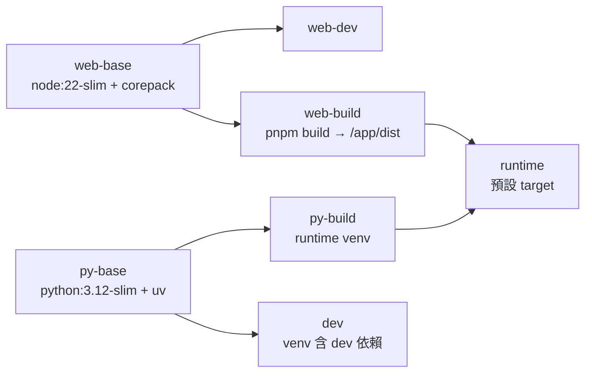
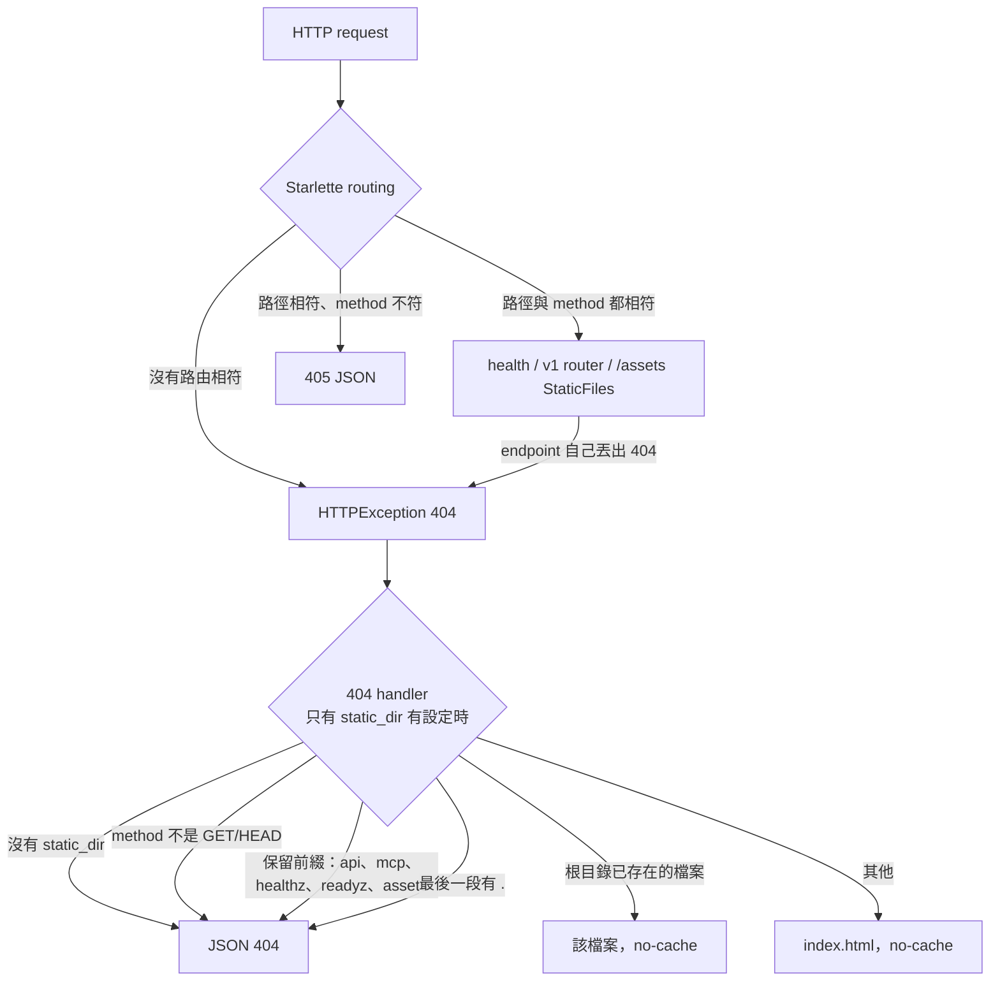

# Design Document

## Overview

本設計建立新版的基礎骨架，分成 4 部分：

1. **後端套件 `appraisal`**（`backend/`）：設定、資料庫連線與命名慣例、logging、健康檢查、空的 `/api/v1` router、SPA 靜態檔服務、啟動程序（等待資料庫 → migration → 啟動 uvicorn）、Alembic baseline、測試資料庫 fixture。
2. **前端骨架**（`frontend/`）：Vite + React 19 + TypeScript strict + Tailwind 4 + shadcn/ui + TanStack Router（檔案路由）+ TanStack Query，一個靜態佔位首頁。
3. **容器與 compose**：一個 `Dockerfile` 含多個 target；`compose.yaml`（共用基礎）、`compose.override.yaml`（開發，compose 自動合併）、`compose.prod.yaml`（正式環境，明確指定）；`.env.example`；`.dockerignore`。
4. **CI 與文件**：`.github/workflows/app-ci.yml`；README 新增新版一節；`.gitignore` 補上新版需要的規則；`.gitattributes` 固定新版檔案的換行字元。

本設計不建立任何資料表或業務端點。後面各段把 router 掛在 `/api/v1`、把 model 加進 `appraisal.models`、用 Alembic 加 revision、把長期背景工作交給 lifespan。

## Steering Document Alignment

### Technical Standards (tech.md)

- 單一 process：uvicorn 一個 worker，以 `--factory appraisal.main:create_app` 啟動；背景工作由 FastAPI lifespan 管理。本段的 lifespan 只負責建立與釋放資料庫 engine。
- 設定只來自 process 環境變數；compose 從 `.env` 取值，並把每個服務需要的變數明確列在 `environment` 中。
- PostgreSQL 17；SQLAlchemy 2 async + asyncpg；schema 只用 Alembic 修改。
- 開發、測試、建置都在容器內執行；主機只需要 podman（或 docker）與 compose。
- 後端測試使用真實 PostgreSQL；fixture 建置失敗算失敗，不跳過。
- 部署：`app` + `postgres`；TLS 由主機反向代理處理，網域從 `.env` 讀取。
- log 訊息、測試名稱、斷言訊息用英文；註解與文件用繁體中文。

### Project Structure (structure.md)

- 後端套件位於 `backend/src/appraisal/`，`api/` 放 router，資料庫基礎放在 `db.py`，model 放在 `models/`。
- Alembic 位於 `backend/alembic/`；測試位於 `backend/tests/`，共用 helper 放在 `backend/tests/fixtures/`。
- 前端位於 `frontend/src/`，`routes/` 是檔案路由，`components/ui/` 放 shadcn/ui 元件，`lib/` 放共用工具。
- 資料庫命名：`ix_`、`uq_`、`fk_`、`ck_`、`pk_` 前綴。
- import 一律從 `appraisal` 開始的絕對路徑；前端用 `@/` alias。

## Code Reuse Analysis

新版是新的目錄樹，不 import、不讀取舊版程式碼。

### Existing Components to Leverage
- **根目錄 `.gitignore`**：已經忽略 `node_modules/`、`dist/`、`.env`、`.env.*`。本段只補上 `!.env.example` 與 Python 快取目錄，不改原有規則。
- **根目錄 `README.md`**：保留原有內容，新增一節。

### Integration Points
- **主機反向代理（nginx-proxy + acme-companion）**：只有正式環境（`compose.prod.yaml`）的 `app` 接上外部 network，透過 `VIRTUAL_HOST`、`VIRTUAL_PORT`、`LETSENCRYPT_HOST` 讓代理自動產生設定與憑證。
- **GitHub Actions**：新增一個 workflow 檔；現有的 `lvr-sync.yml`、`supabase-keepalive.yml` 不動。

## Architecture

### 檔案清單

```
backend/
├── pyproject.toml              # 專案、依賴、ruff / mypy / pytest 設定（hatchling build backend）
├── uv.lock
├── alembic.ini                 # script_location = alembic；不含連線網址
├── alembic/
│   ├── env.py                  # async migration；連線網址來自 config.attributes 或 Settings
│   ├── script.py.mako
│   └── versions/
│       └── 0001_baseline.py    # 空的 baseline revision（revision id `0001`）
├── scripts/
│   └── check_env_contract.py   # CI 用：Settings、compose.yaml、.env.example 的變數清單一致性
├── src/appraisal/
│   ├── __init__.py
│   ├── config.py               # Settings、get_settings()、SettingsError
│   ├── db.py                   # NAMING_CONVENTION、metadata、Base、create_engine()
│   ├── log.py                  # configure_logging()
│   ├── migrations.py           # alembic_config()、upgrade_to_head()
│   ├── startup.py              # 容器預設 command：等待資料庫 → migration → exec uvicorn
│   ├── main.py                 # create_app()、lifespan
│   ├── models/
│   │   └── __init__.py         # 匯入全部 model，讓 metadata 完整（本段為空）
│   └── api/
│       ├── __init__.py
│       ├── health.py           # /healthz、/readyz
│       ├── v1.py               # router（prefix /api/v1，本段沒有端點）
│       ├── deps.py             # get_db_session()
│       └── spa.py              # mount_spa()：/assets 與 404 handler
└── tests/
    ├── __init__.py
    ├── conftest.py             # session 與 function 範圍 fixture
    ├── fixtures/
    │   ├── __init__.py
    │   ├── app_client.py       # open_running_app()、RunningApp
    │   ├── database.py         # create_test_database()
    │   ├── network.py          # unused_local_port()、unresponsive_listener()
    │   └── settings_environment.py   # SETTINGS_ENVIRONMENT_NAMES
    ├── test_config.py
    ├── test_logging.py
    ├── test_health.py
    ├── test_api_v1.py
    ├── test_app_sessions.py
    ├── test_spa.py
    ├── test_startup.py
    ├── test_migrations.py
    ├── test_naming.py
    └── test_isolation.py

frontend/
├── package.json                # packageManager 固定 pnpm 版本；scripts
├── pnpm-lock.yaml
├── index.html                  # lang="zh-Hant-TW"
├── vite.config.ts              # plugins、alias、dev server、proxy、vitest 設定
├── tsconfig.json               # strict
├── tsconfig.app.json
├── tsconfig.node.json
├── components.json             # shadcn/ui 設定（style `radix-nova`）
├── eslint.config.js            # flat config
├── .prettierrc
├── .prettierignore
└── src/
    ├── main.tsx                # QueryClientProvider + RouterProvider
    ├── index.css               # Tailwind 4 與 shadcn/ui 產生的 CSS 變數
    ├── routeTree.gen.ts        # TanStack Router 產生，提交到 git
    ├── routes/
    │   ├── __root.tsx          # 根 layout（只有 <Outlet />）
    │   └── index.tsx           # 佔位首頁
    ├── components/ui/
    │   └── .gitkeep            # 本段沒有元件，只放這個檔案讓目錄進入版本控制；shadcn/ui 元件之後加在這裡
    ├── lib/utils.ts            # 轉出 `cn` 套件的 cn()
    └── test/
        ├── setup.ts            # Testing Library 的 jest-dom matcher
        └── home.test.tsx       # 首頁冒煙測試

Dockerfile
.dockerignore
.gitattributes                  # 新版路徑的換行字元固定為 LF
compose.yaml                    # 共用基礎：postgres、app、backend network
compose.override.yaml           # 開發：compose 在沒有 -f 時自動合併
compose.prod.yaml               # 正式環境：反向代理 network、VIRTUAL_*、restart
.env.example
.github/workflows/app-ci.yml
.gitignore                      # 既有檔案：只在最後新增規則
README.md                       # 既有檔案：在原有內容之前新增新版一節
```

### 容器內的目錄配置

`dev` 與 `runtime` 兩個 target 使用相同的配置，讓 `migrations.py` 用同一種方式找到 Alembic：

| 路徑 | 內容 |
|------|------|
| `/app/` | 後端根目錄（`alembic.ini`、`alembic/`、`src/`）。dev 中是 `./backend` 的 bind mount |
| `/opt/venv/` | Python 虛擬環境；專案以 editable 方式安裝，指向 `/app/src`。dev 中是 named volume `dev_venv` |
| `/app/static/` | 前端 `dist`（只有 `runtime` 有） |
| `/cache/` | 只有 dev：named volume `dev_cache`，放 uv、ruff、mypy、pytest 的快取，不寫進 bind mount |

### Dockerfile target



### 請求路由



### Modular Design Principles

- `config.py`、`db.py`、`log.py` 不依賴 FastAPI，啟動程序、Alembic 與測試都可以直接使用。
- `create_app()` 接受一個 `Settings`，不讀全域狀態以外的東西；測試用不同的 `Settings` 建立不同的 app（例如指向無法連線的資料庫）。
- 啟動程序是一個 Python module，不是 shell 腳本：Windows 上的開發者也不會遇到換行字元問題，而且可以在測試中以 subprocess 執行。

## Components and Interfaces

### Settings（`appraisal/config.py`）
- **Purpose:** 從 process 環境變數讀取並驗證設定。
- **Interfaces:**
  ```python
  class Settings(BaseSettings):
      model_config = SettingsConfigDict(env_file=None, case_sensitive=False, env_ignore_empty=True)
      # 欄位見 Data Models
      def database_url(self, database: str | None = None) -> sqlalchemy.engine.URL:
          """回傳 postgresql+asyncpg 的連線網址；database 不給時用 postgres_db。
          URL 物件的文字表示會遮住密碼。"""

  class SettingsError(RuntimeError):
      """設定缺少或無效。訊息列出每一個有問題的環境變數名稱（大寫）。"""

  def get_settings() -> Settings:
      """讀取並快取 Settings（functools.lru_cache）。
      pydantic 的 ValidationError 轉成 SettingsError，訊息例如：
      'Missing required environment variable(s): POSTGRES_USER, POSTGRES_PASSWORD'。"""
  ```
- **Dependencies:** pydantic-settings、SQLAlchemy（URL）。
- **Reuses:** 無。
- `env_ignore_empty=True`：值是空字串的環境變數視為沒有設定。必要欄位是空字串時，和缺少一樣列在 `SettingsError` 中；選用欄位是空字串時使用預設值。compose 用 `${VAR:-}` 把變數傳給 `app`，沒有在 `.env` 中設定的變數會變成空字串，這個設定讓它們回到 Settings 的預設值。
- 預設值只寫在這裡。compose 與 Dockerfile 不重複寫這些預設值；唯一的例外是 `runtime` image 設定 `STATIC_DIR=/app/static`，因為只有這個 image 帶有前端檔案。

### 資料庫基礎（`appraisal/db.py`）
- **Purpose:** 命名慣例、共用的 `MetaData` 與 declarative base、建立 engine 與 sessionmaker。
- **Interfaces:**
  ```python
  NAMING_CONVENTION: dict[str, str]          # 見 Data Models
  metadata: MetaData                          # MetaData(naming_convention=NAMING_CONVENTION)
  class Base(DeclarativeBase): metadata = metadata
  def create_engine(settings: Settings, *, database: str | None = None) -> AsyncEngine
  def create_sessionmaker(bind: AsyncEngine | AsyncConnection, **kwargs: Any) -> async_sessionmaker[AsyncSession]
      """async_sessionmaker(bind, expire_on_commit=False, **kwargs)。"""
  ```
- `create_engine()` 使用 `pool_pre_ping=True`：連線池中的連線可能因為資料庫重新啟動或網路閒置而被切斷；每次取出連線前先檢查，壞掉就換一條，所以資料庫重新啟動後的第一個請求不會失敗。
- **Dependencies:** SQLAlchemy 2（asyncio）、asyncpg、`config`。
- 本段沒有 model。`appraisal/models/__init__.py` 是 model 的登記處，Alembic 的 `env.py` 匯入它，讓 `metadata` 包含全部資料表。

### Logging（`appraisal/log.py`）
- **Purpose:** 設定標準 logging；這是唯一設定 logging 的地方（Alembic 不另外設定）。
- **Interfaces:** `def configure_logging(level: str) -> None` — 在 root logger 上設定一個 stderr handler，格式 `%(asctime)s %(levelname)s %(name)s %(message)s`，root 與 `appraisal` logger 的等級都設成 `level`（所以 Alembic 的 INFO 訊息也會出現）。重複呼叫不會增加 handler。
- **Dependencies:** 標準函式庫。

### Migration 輔助（`appraisal/migrations.py`）
- **Purpose:** 讓啟動程序與測試用同一種方式執行 Alembic。
- **Interfaces:**
  ```python
  BACKEND_ROOT: Path   # Path(__file__).resolve().parents[2]，即 /app
  def alembic_config(database_url: URL) -> alembic.config.Config:
      """讀取 BACKEND_ROOT / 'alembic.ini'，並把 database_url 放進 config.attributes['database_url']。"""
  def upgrade_to_head(database_url: URL) -> None
  def downgrade_to_base(database_url: URL) -> None
  ```
- `alembic/env.py` 用 `asyncio.run()` 執行 async migration。所以這幾個函式是同步函式，不能在執行中的 event loop 裡直接呼叫；async 的呼叫端（測試 fixture）用 `asyncio.to_thread()` 呼叫。
- `env.py` 的連線網址順序：`config.attributes['database_url']` → `get_settings().database_url()`。`alembic.ini` 不含連線網址，也不含 logger 設定段落。
- `env.py` 不呼叫 `logging.config.fileConfig()`：它會關掉已經存在的 logger，蓋掉 `configure_logging()` 的設定。

### Alembic baseline（`backend/alembic/versions/0001_baseline.py`）
- **Purpose:** 一個空的起點 revision。後面各段在它之後加入真正的資料表。
- **Interfaces:**
  ```python
  revision = "0001"
  down_revision = None
  def upgrade() -> None: ...    # 不做事
  def downgrade() -> None: ...  # 不做事
  ```
- revision id 固定為 `0001`，不使用 Alembic 自動產生的亂數 id，檔名與 id 一致。
- 執行後資料庫中只有 `alembic_version` 表。
- **Dependencies:** Alembic。

### 啟動程序（`appraisal/startup.py`）
- **Purpose:** 容器的預設 command：`python -m appraisal.startup [額外的 uvicorn 參數...]`。
- **Interfaces:** `def main(argv: list[str] | None = None) -> NoReturn`；結束碼：

  | 結束碼 | 意義 |
  |-------|------|
  | 2 | 設定缺少或無效（`SettingsError`） |
  | 3 | 在 `startup_db_wait_seconds` 內一直無法連上資料庫 |
  | 4 | `alembic upgrade head` 失敗 |
  | 由 uvicorn 決定 | 成功時 process 被 uvicorn 取代 |

- **流程：**
  1. `get_settings()`；失敗時印出 `SettingsError` 的訊息到 stderr，結束碼 2。
  2. `configure_logging(settings.log_level)`。
  3. 等待資料庫：每次嘗試用 `create_engine(settings)` 連線並執行 `SELECT 1`，單次嘗試的上限是 `CONNECT_ATTEMPT_TIMEOUT_SECONDS`（5 秒，用 `asyncio.timeout` 包住整次嘗試，所以伺服器接受連線但不回應時也會逾時）；失敗就記一筆 WARNING（`Database not reachable yet (attempt {n}): {exception class name}`），等 2 秒再試，直到從開始算起超過 `startup_db_wait_seconds`。超過時記一筆 ERROR（`Database not reachable within {n} seconds, giving up`），結束碼 3。最長的結束時間是 `startup_db_wait_seconds` + 5 + 2 秒。log 中只放例外的類別名稱，不放連線網址。
  4. `upgrade_to_head(settings.database_url())`；任何例外記一筆 ERROR（`Database migration failed`，附 traceback），結束碼 4。
  5. `os.execvp("uvicorn", ["uvicorn", "--factory", "appraisal.main:create_app", "--host", "0.0.0.0", "--port", "8000", "--workers", "1", "--forwarded-allow-ips", settings.forwarded_allow_ips, *argv])`。dev target 的預設 command 帶 `--reload --reload-dir /app/src`。
- `--forwarded-allow-ips` 預設 `*`（信任任何來源的 `X-Forwarded-*` header）：正式環境中 `app` 的 port 沒有發布，只有同一個 network 上的反向代理連得到它；開發環境只發布在 127.0.0.1。部署環境不同時，用 `FORWARDED_ALLOW_IPS` 縮小範圍。
- 現在只有一個 process 執行 migration，所以不加鎖。程式碼註解說明：如果將來有多個 replica 同時啟動，要在 migration 前取得 PostgreSQL advisory lock。
- **Dependencies:** `config`、`db`、`log`、`migrations`。
- 它是 image 的 `CMD`，不是 `ENTRYPOINT`：`compose run --rm app pytest` 這類指令會取代它，只執行指定的指令。

### Application factory（`appraisal/main.py`）
- **Purpose:** 建立 FastAPI app。
- **Interfaces:**
  ```python
  def create_app(
      settings: Settings | None = None,
      *,
      sessionmaker: async_sessionmaker[AsyncSession] | None = None,
  ) -> FastAPI:
      """settings 不給時用 get_settings()。sessionmaker 給了時，lifespan 使用它，不另外建立。"""
  ```
- **lifespan：** 啟動時一定建立 `app.state.engine = create_engine(settings)`（`/readyz` 使用）；`app.state.sessionmaker` 是傳入的 `sessionmaker`，沒有傳入時是 `create_sessionmaker(app.state.engine)`。結束時 `await engine.dispose()`（傳入的 sessionmaker 由呼叫端管理）。sessionmaker 在 lifespan 開始前就決定，所以 lifespan 中啟動的背景工作拿到的也是同一個。後面各段的長期背景工作也在這裡啟動與停止。
- **取得資料庫 session 的規則：** 之後所有程式（請求處理、背景工作）一律從 `app.state.sessionmaker` 取得 session，不自己建立 engine 或 sessionmaker。請求處理透過 `get_db_session` dependency；背景工作在 lifespan 中拿到同一個 sessionmaker。只有一個來源，測試才能在建立 app 時傳入綁在測試 transaction 上的版本，讓 API 與背景工作寫入的資料也在測試結束時 rollback。`/readyz` 是唯一直接使用 `app.state.engine` 的地方，因為它檢查的是能不能取得連線，不是存取資料。
- **路由註冊順序：**
  1. `health.router`（`/healthz`、`/readyz`）
  2. `v1.router`（`/api/v1`）
  3. `static_dir` 不是 `None` 時：`mount_spa(app, settings.static_dir)`（掛載 `/assets` 並註冊 404 handler）。沒有任何 catch-all route，所以 Starlette 的 405 判斷不受影響。
- 呼叫 `configure_logging(settings.log_level)`。
- **Dependencies:** `config`、`db`、`log`、`api.health`、`api.v1`、`api.spa`、`api.deps`。

### 健康檢查（`appraisal/api/health.py`）
- **Purpose:** 存活與可服務檢查。
- **Interfaces:**

  | 端點 | 成功 | 失敗 |
  |------|------|------|
  | `GET /healthz` | 200 `{"status": "ok"}`，不碰資料庫 | — |
  | `GET /readyz` | 200 `{"status": "ok"}` | 503 `{"status": "unavailable"}` |

- `/readyz` 在 `asyncio.timeout(READINESS_TIMEOUT_SECONDS)`（2.0 秒）內透過 `app.state.engine` 執行 `SELECT 1`。任何例外或逾時都回 503；記一筆 WARNING（`Readiness check failed: {exception class name}`）；回應內容不含例外訊息。
- **Dependencies:** `app.state.engine`。

### API v1 router（`appraisal/api/v1.py`）
- **Purpose:** 後面各段掛載端點的地方。
- **Interfaces:** `router = APIRouter(prefix="/api/v1")`；本段沒有端點。
- **Dependencies:** 只有 FastAPI。

### 資料庫 session dependency（`appraisal/api/deps.py`）
- **Purpose:** 給請求處理使用的 session。
- **Interfaces:**
  ```python
  async def get_db_session(request: Request) -> AsyncIterator[AsyncSession]:
      """async with request.app.state.sessionmaker() as session: yield session"""
  ```
- 它不 commit。commit 或 rollback 由使用它的 Service 決定；請求結束時 session 關閉，沒有 commit 的變更會被丟棄。
- **Dependencies:** `app.state.sessionmaker`。

### SPA 靜態檔（`appraisal/api/spa.py`）
- **Purpose:** 提供建置好的前端，並讓所有沒有對應路由的請求得到一致的回應。
- **Interfaces:** `def mount_spa(app: FastAPI, static_dir: Path) -> None`（只在 `settings.static_dir` 有值時由 `create_app` 呼叫）
  - 如果 `static_dir / "index.html"` 不存在，丟出 `RuntimeError`（`SPA index.html not found in {static_dir}`），讓啟動失敗。
  - 如果 `static_dir / "assets"` 目錄不存在，`StaticFiles` 在建立時就檢查目錄並丟出 `RuntimeError`（訊息含該目錄路徑），同樣讓啟動失敗。不把這個檢查延到請求時：建置不完整的前端應該在啟動時就被發現。
  - 掛載 `/assets` → `static_dir / "assets"`，使用 `StaticFiles` 的子類別，對成功的回應加上 `Cache-Control: public, max-age=31536000, immutable`。檔案不存在時回 404。Vite 產生的檔名含內容 hash，所以可以長期快取。
  - 註冊 404 handler：`app.add_exception_handler(StarletteHTTPException, spa_not_found_handler)`。不註冊任何 catch-all route。handler 只處理 `status_code == 404`，其他狀態碼（包含 405）交給 FastAPI 預設的 `http_exception_handler`，所以存在的路徑用錯 method 時仍然是 405 JSON。404 的判斷順序：
    1. method 不是 GET 或 HEAD → 預設的 JSON 404 `{"detail": "Not Found"}`。
    2. 第一段是保留前綴 `api`、`mcp`、`healthz`、`readyz`、`assets` → 預設的 JSON 404。
    3. `path` 只有一段，而且 `static_dir / path` 是存在的檔案（例如 Vite `public/` 複製到根目錄的 `favicon.ico`）→ 回傳該檔案，`Cache-Control: no-cache`。解析後的路徑必須在 `static_dir` 之內，否則當成不存在。
    4. 最後一段含有 `.` → 預設的 JSON 404。
    5. 其他 → `index.html`，`Cache-Control: no-cache`，status 200。
  - HEAD 的回應和 GET 有相同的 status 與 header，沒有 body。
  - 這個 handler 同時收到「沒有路由相符」的 404 與 endpoint 自己丟出的 `HTTPException(404)`，兩者無法區分。第 2 條保證後者不會變成網頁：所有後端端點都放在保留前綴之下（`/api`、`/mcp`、`/healthz`、`/readyz`、`/assets`）。之後新增的後端端點也必須放在這些前綴之下；需要新的頂層前綴時，同時把它加進保留前綴清單。
  - 沒有結尾斜線的 `GET /assets` 由 Starlette 的 redirect_slashes 回 307 轉到 `/assets/`，`/assets/` 再回 JSON 404（保留前綴）。這是接受的行為：兩步都不會得到前端網頁。
  - 沒有 `static_dir`（開發環境）時不呼叫 `mount_spa`，所有 404 都是預設的 JSON 404。405 的行為在開發與正式環境相同。
- 前端 route 的路徑參數不能含有 `.`（第 4 條會把它當成檔案）；含有 `.` 的值（例如 token）放在 query string。
- **Dependencies:** Starlette `StaticFiles`、`FileResponse`、`HTTPException`；FastAPI 的 `http_exception_handler`。

### 測試資料庫與共用 fixture（`backend/tests/fixtures/`、`backend/tests/conftest.py`）
- **Purpose:** 每次測試執行使用一次性資料庫；每個測試的寫入都在結束時 rollback。
- **Interfaces:**
  ```python
  @asynccontextmanager
  async def create_test_database(settings: Settings, *, migrate: bool = True) -> AsyncIterator[Settings]:
      """建立名稱為 f"{settings.postgres_db}_test_{secrets.token_hex(4)}" 的資料庫，
      migrate=True 時升級到 head，yield 指向它的 Settings（model_copy，只改 postgres_db）。
      離開時 DROP DATABASE ... WITH (FORCE)，只刪除自己建立的那個資料庫。
      建立或 migration 的例外原樣往外丟。"""
  ```
  - CREATE / DROP 透過連到 `settings.postgres_db` 的 AUTOCOMMIT 連線執行；除了建立與刪除一次性資料庫，不對主要資料庫做任何事。
  - migration 透過 `asyncio.to_thread(upgrade_to_head, url)` 執行。

  其他共用 helper：
  ```python
  # tests/fixtures/app_client.py
  @dataclass(frozen=True)
  class RunningApp:
      app: FastAPI
      client: httpx.AsyncClient

  @asynccontextmanager
  async def open_running_app(
      settings: Settings, sessionmaker: async_sessionmaker[AsyncSession] | None = None
  ) -> AsyncIterator[RunningApp]:
      """create_app(settings, sessionmaker=...)，在 lifespan 中 yield app 與綁在它上面的
      httpx.AsyncClient（ASGITransport，base_url="http://test"）；離開時關閉兩者。"""

  # tests/fixtures/network.py
  def unused_local_port() -> int: ...                # 沒有程式在聽的本機 port，連線立刻被拒絕
  @contextmanager
  def unresponsive_listener() -> Iterator[int]: ...  # 接受 TCP 連線但從不回應的本機 listener 的 port

  # tests/fixtures/settings_environment.py
  SETTINGS_ENVIRONMENT_NAMES: tuple[str, ...]        # 由 Settings.model_fields 推導的環境變數名稱
  ```
  - `open_running_app()` 是測試建立並啟動 app 的唯一方式，所以每個測試的 app 都執行同樣的 lifespan 與 client 設定。測試可以在它 yield 之後、送出第一個請求之前，對 app 加入暫時的路由。它在函式內才 import `create_app`，所以模組在應用程式進入點完成之前也能載入。
  - `SETTINGS_ENVIRONMENT_NAMES` 由 `Settings.model_fields` 推導，新增 Settings 欄位時自動包含，測試不另外維護變數清單。
  - 中斷的執行（例如 Ctrl+C 兩次）可能留下 `*_test_*` 資料庫。不做自動清理：同一套服務上同時執行的兩次 pytest 會刪掉對方的資料庫。README 提供手動清理的指令。

  `conftest.py` 的 fixture：

  | Fixture | 範圍 | 內容 |
  |---------|------|------|
  | `base_settings` | session | `get_settings()`（指向 compose 的 `postgres`） |
  | `test_settings` | session | `create_test_database(base_settings)` yield 的 Settings |
  | `engine` | session | `create_engine(test_settings)`；結束時 dispose |
  | `db_connection` | function | 從 `engine` 開一個連線並 `begin()` 外層 transaction；測試結束時 rollback 並關閉 |
  | `sessionmaker` | function | `create_sessionmaker(db_connection, join_transaction_mode="create_savepoint")`：測試中的 commit 只釋放 SAVEPOINT，外層 transaction 結束時全部 rollback |
  | `db_session` | function | `sessionmaker()` 開的 session |
  | `running_app` | function | `open_running_app(test_settings, sessionmaker=sessionmaker)` yield 的 `RunningApp` |
  | `app` | function | `running_app.app` |
  | `client` | function | `running_app.client` |

  - pytest-asyncio：`asyncio_mode = "auto"`，fixture 與測試的預設 loop scope 都是 `session`；engine、連線與 HTTP client 都在同一個 event loop 上。
  - 限制：一個測試中的所有請求共用一條連線，所以測試中不能同時送出多個請求（要依序 await）。串流回應（例如之後的 SSE）不能用這種方式測試，由那一段設計另外的方式。
  - 沒有任何 `pytest.skip`：資料庫連不上、建立失敗、migration 失敗都讓測試失敗。在 compose 中資料庫一定存在，不需要「取得資源失敗就跳過」的路徑。
- **Dependencies:** `config`、`db`、`migrations`、`main`（只在 `open_running_app()` 中）、httpx。

### 前端骨架（`frontend/`）
- **Purpose:** 後面各段建立畫面的起點。
- **Interfaces:**
  - `package.json` scripts：

    | script | 指令 |
    |--------|------|
    | `dev` | `vite --host 0.0.0.0 --port 5173 --strictPort` |
    | `build` | `tsc -b && vite build` |
    | `typecheck` | `tsc -b` |
    | `lint` | `eslint .` |
    | `test` | `vitest run` |
    | `format` / `format:check` | `prettier --write .` / `prettier --check .` |

  - `vite.config.ts`：
    - plugins 順序：`tanstackRouter({ target: 'react', autoCodeSplitting: true })`、`react()`、`tailwindcss()`。
    - alias `@` → `src`。
    - `server.proxy`：`/api` 與 `/mcp` 轉到 `process.env.DEV_PROXY_TARGET ?? 'http://app:8000'`。
    - `server.watch.usePolling`：`process.env.DEV_USE_POLLING === '1'`。
    - `server.hmr.clientPort`：`process.env.DEV_HMR_CLIENT_PORT` 有值時使用（主機發布的 port 和容器內 5173 不同時，瀏覽器才連得到 HMR）。
    - `test`：`environment: 'jsdom'`、`setupFiles: ['src/test/setup.ts']`。
    - 這些環境變數不使用 `VITE_` 前綴，所以不會被打包進前端程式。
  - `src/routes/index.tsx`：佔位首頁，顯示標題「不動產估價報告系統」與一行「新版建置中」。不呼叫 API，不加視覺設計。
  - `src/main.tsx`：建立 `QueryClient` 與 router，render `QueryClientProvider` + `RouterProvider`。
  - shadcn/ui 使用以 Radix 為基礎的 style `radix-nova`。本段不選字型，也不選視覺 preset：`index.css` 中 neutral 的 CSS 變數只是佔位，視覺設計階段再決定；不加入 `@base-ui/react`，也不加入字型套件。
  - `routeTree.gen.ts` 提交到 git，並列在 `.prettierignore` 與 ESLint 的忽略清單中。
  - route 的路徑參數不能含有 `.`（見 SPA fallback 規則）；含有 `.` 的值放在 query string。
  - `tsconfig.*.json` 的 `tsBuildInfoFile` 指向 `node_modules/.tmp/`，Vite 與 Vitest 的快取也在 `node_modules/` 下；`node_modules` 是 named volume，所以這些快取不會寫進工作目錄。
- **Dependencies:** react、react-dom、@tanstack/react-router、@tanstack/react-query；shadcn/ui init 產生的依賴（class-variance-authority、cn、shadcn、lucide-react、tw-animate-css）；dev：vite、@vitejs/plugin-react、@tanstack/router-plugin、tailwindcss、@tailwindcss/vite、typescript、vitest、jsdom、@testing-library/react、@testing-library/jest-dom、eslint、typescript-eslint、eslint-plugin-react-hooks、eslint-plugin-react-refresh、prettier、@types/react、@types/react-dom、@types/node。
- `cn` 與 `shadcn` 是執行期依賴：目前的 shadcn/ui 產生的 `lib/utils.ts` 從 `cn` 套件轉出 `cn()`，`index.css` import `shadcn/tailwind.css`；所以不使用 `clsx` 與 `tailwind-merge`。

### 後端專案設定（`backend/pyproject.toml`）
- **依賴：** fastapi、uvicorn[standard]、sqlalchemy[asyncio]、asyncpg、alembic、pydantic、pydantic-settings。
- **dev 群組：** ruff、mypy、pytest、pytest-asyncio、httpx（測試用的 `AsyncClient` 與 `ASGITransport`）。
- **ruff：** `target-version = "py312"`、`line-length = 100`、`select = ["E", "F", "I", "B", "UP", "SIM", "ASYNC", "RUF"]`；isort 的 first-party 是 `appraisal`。
- **mypy：** `strict = true`、`plugins = ["pydantic.mypy"]`、檢查 `src`、`tests` 與 `scripts`。
- **pytest：** `testpaths = ["tests"]`、`asyncio_mode = "auto"`、`asyncio_default_fixture_loop_scope = "session"`、`asyncio_default_test_loop_scope = "session"`。

### Dockerfile
- **Purpose:** 一個檔案建出開發與正式環境需要的全部 image。
- **Targets：**

  | Target | 基底 | 內容 |
  |--------|------|------|
  | `web-base` | `node:22-slim` | `corepack enable`；`COREPACK_ENABLE_DOWNLOAD_PROMPT=0`；`WORKDIR /app` |
  | `web-dev` | `web-base` | 只複製 `frontend/package.json`，執行 `corepack install` 取得固定版本的 pnpm，再執行一次 `pnpm --version`，讓 pnpm 執行檔存進 image，啟動容器時不需要下載（離線也能啟動）；`npm_config_store_dir=/pnpm/store`；開發用 entrypoint（見下）；`CMD ["pnpm", "dev"]` |
  | `web-build` | `web-base` | 複製 `package.json` 與 `pnpm-lock.yaml`，`pnpm install --frozen-lockfile`（cache mount `/pnpm/store`）；複製 `frontend/`；`pnpm build` 產生 `/app/dist` |
  | `py-base` | `python:3.12-slim` | 從固定版本的 `ghcr.io/astral-sh/uv` image 複製 `uv`；`UV_PROJECT_ENVIRONMENT=/opt/venv`、`UV_COMPILE_BYTECODE=1`、`UV_LINK_MODE=copy`、`PATH=/opt/venv/bin:$PATH`、`PYTHONUNBUFFERED=1`；`WORKDIR /app` |
  | `py-build` | `py-base` | 複製 `pyproject.toml`、`uv.lock`，`uv sync --locked --no-dev --no-install-project`（cache mount）；複製 `backend/src`；`uv sync --locked --no-dev` |
  | `dev` | `py-base` | 包含 dev 依賴：`uv sync --frozen --no-install-project`、複製後 `uv sync --frozen`（不檢查 lock 檔是否過期，所以 lock 檔過期時仍然能建置，再在容器中修復 lock 檔）；複製整個 `backend/`；`ENV PYTHONDONTWRITEBYTECODE=1 UV_CACHE_DIR=/cache/uv RUFF_CACHE_DIR=/cache/ruff MYPY_CACHE_DIR=/cache/mypy PYTEST_ADDOPTS="-o cache_dir=/cache/pytest"`；開發用 entrypoint（見下）；`EXPOSE 8000`；`CMD ["python", "-m", "appraisal.startup", "--reload", "--reload-dir", "/app/src"]` |
  | `runtime` | `python:3.12-slim` | 建立 uid 10001 的 `app` 使用者；複製 `py-build` 的 `/opt/venv` 與 `/app/src`、`backend/alembic.ini`、`backend/alembic/`、`web-build` 的 `/app/dist` 到 `/app/static`；`python -m compileall -q /app/src`；`ENV PATH=/opt/venv/bin:$PATH PYTHONUNBUFFERED=1 STATIC_DIR=/app/static`；`USER app`；`EXPOSE 8000`；`CMD ["python", "-m", "appraisal.startup"]`。放在檔案最後，是預設 target |

- `runtime` 與 `py-base` 使用同一個 `python:3.12-slim` tag，讓 venv 中指向 Python 執行檔的連結有效。
- `runtime` 不含 uv、node、pnpm 或 dev 依賴。
- cache mount（`RUN --mount=type=cache`）只用來加速；不支援時，建置仍然成功。
- 正式環境的 image 建置是嚴格的：`py-build` 用 `uv sync --locked`，`web-build` 用 `pnpm install --frozen-lockfile`，lock 檔和依賴宣告不一致時建置失敗。`dev` 用 `uv sync --frozen`，不檢查 lock 檔是否過期，所以開發環境一定能建置，lock 檔可以在容器中用 `uv lock` 修復；`web-dev` 建置時不安裝依賴。開發流程中的嚴格檢查由 CI 的 `uv lock --check` 負責。
- **開發用 entrypoint**（`dev` 與 `web-dev`）：每次啟動或 `compose run` 時，先依 lock 檔同步依賴，再執行指定的指令：
  - `dev`：`uv sync --locked`
  - `web-dev`：`pnpm install --frozen-lockfile --prefer-offline`

  同步失敗（例如 lock 檔和依賴宣告不一致）時，在 stderr 印出一行英文警告（`WARNING: dependency sync failed; dependencies may be out of date. Regenerate the lock file.`），然後照樣執行指定的指令。這樣重新產生 lock 檔的指令（`uv lock`、`pnpm install`）在 lock 檔過期時仍然能執行。entrypoint 寫成 `ENTRYPOINT ["sh", "-c", "<sync> || echo '<warning>' >&2; exec \"$@\"", "--"]`。
  - 必須在 entrypoint 同步：venv 與 `node_modules` 都在 named volume 中，volume 只有在第一次建立時才從 image 複製內容，之後 image 更新不會反映到 volume。

### `.dockerignore`
排除：`.git`、`.env`、`.env.*`、`**/node_modules`、`**/__pycache__`、`**/.pytest_cache`、`**/.mypy_cache`、`**/.ruff_cache`、`**/.venv`、`dist`、`frontend/dist`、`core`、`lib`、`mcp`、`tools`、`test`、`supabase`、`.spec`、`.github`。

### compose 檔案的分工

| 檔案 | 用途 | 使用方式 |
|------|------|---------|
| `compose.yaml` | 開發與正式環境共用的部分 | 一定會被讀取 |
| `compose.override.yaml` | 開發 | 沒有 `-f` 時，docker compose 與 podman-compose 都會自動合併它；所以開發只要 `podman compose up`、`podman compose run --rm app pytest` |
| `compose.prod.yaml` | 正式環境 | 一定明確指定：`podman compose -f compose.yaml -f compose.prod.yaml up -d`；有 `-f` 時不會讀取 `compose.override.yaml` |

開發環境不接上反向代理的 network，也收不到 `VIRTUAL_*` 的值：這些只寫在 `compose.prod.yaml` 中。正式環境的指令一律寫出 `-f compose.yaml -f compose.prod.yaml`。伺服器管理者可以在自己 shell 的 profile 中 `export COMPOSE_FILE=compose.yaml:compose.prod.yaml` 來省略 `-f`（Windows 的分隔字元是 `;`）；專案的檔案不設定它。

### `compose.yaml`（共用基礎）

| 服務 | 設定 |
|------|------|
| `postgres` | `image: postgres:17`；`environment`：`POSTGRES_USER: ${POSTGRES_USER}`、`POSTGRES_PASSWORD: ${POSTGRES_PASSWORD}`、`POSTGRES_DB: ${POSTGRES_DB}`；volume `pgdata:/var/lib/postgresql/data`；network `backend`；healthcheck `pg_isready -h 127.0.0.1 -U "$${POSTGRES_USER}" -d "$${POSTGRES_DB}"`；沒有 `ports` |
| `app` | `build: { context: ., target: runtime }`；`environment`：Settings 讀取的每一個變數以 `${VAR:-}` 列出（`POSTGRES_HOST`、`POSTGRES_PORT`、`POSTGRES_USER`、`POSTGRES_PASSWORD`、`POSTGRES_DB`、`LOG_LEVEL`、`STARTUP_DB_WAIT_SECONDS`、`FORWARDED_ALLOW_IPS`）；`depends_on: { postgres: { condition: service_healthy } }`；network `backend`；healthcheck 用 `CMD-SHELL` 執行 `python -c "import urllib.request; urllib.request.urlopen('http://127.0.0.1:8000/healthz', timeout=3)"`（podman 會把 exec 形式中含空白的單一參數切開，所以不用 `CMD`）；沒有 `ports` |

- 兩個服務都不用 `env_file`：每個服務只拿到明確列出的變數，`.env` 中其他用途的值（例如 `VIRTUAL_HOST`）不會進入不需要它的容器。沒有在 `.env` 設定的變數以空字串傳入，Settings 把空字串視為沒有設定並使用預設值（見 Settings）。
- `postgres` 的 healthcheck 用 `-h 127.0.0.1` 走 TCP：第一次初始化資料庫時，暫時的伺服器只聽 Unix socket，只檢查 socket 會在 `app` 這類 TCP 用戶端還連不上時就回報 healthy。
- `STATIC_DIR` 不列在 `app.environment` 中：列出時空字串會蓋掉 `runtime` image 設定的 `/app/static`。
- 新增 Settings 欄位時，要同時加到 `app.environment` 與 `.env.example`。
- networks：`backend`（一般 bridge）。volumes：`pgdata`。
- 不寫 `container_name`、頂層 `name:`，不用 podman 或 docker 專屬的欄位。
- `depends_on` 的條件只是輔助；不同的 compose provider 支援程度不同，真正的等待由啟動程序負責。

### `compose.prod.yaml`（正式環境）

| 服務 | 覆寫內容 |
|------|---------|
| `postgres` | `restart: unless-stopped` |
| `app` | `environment`：`VIRTUAL_HOST: ${VIRTUAL_HOST:?set VIRTUAL_HOST in .env}`、`LETSENCRYPT_HOST: ${LETSENCRYPT_HOST:?set LETSENCRYPT_HOST in .env}`、`VIRTUAL_PORT: "8000"`（image 內固定的 port）；networks `backend`、`proxy`；`restart: unless-stopped`；healthcheck `interval: 30s`、`timeout: 5s`、`retries: 3`、`start_period: 90s`（涵蓋等待資料庫與 migration 的時間） |

- networks：`proxy`：`external: true`、`name: ${PROXY_NETWORK:?set PROXY_NETWORK in .env}`。沒有預設名稱：缺少時 compose 直接報錯，不會接到錯誤的 network。

### `compose.override.yaml`（開發）

| 服務 | 覆寫內容 |
|------|---------|
| `postgres` | `ports: ["127.0.0.1:${POSTGRES_HOST_PORT:-5432}:5432"]` |
| `app` | `build.target: dev`；`volumes`：`./backend:/app`、`dev_venv:/opt/venv`、`dev_cache:/cache`；`environment`：`WATCHFILES_FORCE_POLLING: ${DEV_USE_POLLING:-}`；`ports: ["127.0.0.1:${APP_HOST_PORT:-8000}:8000"]` |
| `web`（新增） | `build: { context: ., target: web-dev }`；`volumes`：`./frontend:/app`、`web_node_modules:/app/node_modules`、`pnpm_store:/pnpm/store`；`environment`：`DEV_USE_POLLING: ${DEV_USE_POLLING:-}`、`DEV_HMR_CLIENT_PORT: ${WEB_HOST_PORT:-5173}`；`ports: ["127.0.0.1:${WEB_HOST_PORT:-5173}:5173"]`；network `backend`；沒有 `depends_on`（`compose run --rm web pnpm test` 不需要啟動 `app` 與 `postgres`；`up` 時 proxy 在 `app` 啟動前回應 502，`app` 就緒後自動恢復） |

- volumes：`dev_venv`、`dev_cache`、`web_node_modules`、`pnpm_store`。
- `./backend` 整個掛到 `/app`，所以容器內 `uv add`／`uv lock` 產生的 `pyproject.toml` 與 `uv.lock` 直接寫回工作目錄。venv 在 named volume `dev_venv`，不會被 bind mount 蓋掉，並由 entrypoint 依 lock 檔同步。
- 日常指令不寫檔案到 bind mount：`PYTHONDONTWRITEBYTECODE=1`，uv、ruff、mypy、pytest 的快取都在 `/cache`（`dev_cache`），前端的快取在 `node_modules` volume。只有使用者自己執行的依賴指令（`uv add`、`uv lock`、`pnpm add`、`pnpm install`）會寫回 lock 檔與依賴宣告。
- `node_modules` 在 named volume，不在 bind mount 中，所以主機上不會出現 Linux 的原生模組。
- 寫回檔案的擁有者：rootless podman 與 Docker Desktop 會把容器內的 root 對應到主機使用者；Linux 上的 rootful docker 會寫出 root 擁有的檔案。README 說明這個情況與 `chown` 的處理方式。
- 不加 SELinux 的 `:Z`／`:z`；README 說明在啟用 SELinux 的主機上需要時自行加上。
- `DEV_USE_POLLING=1` 同時讓 Vite 與 uvicorn reload（`WATCHFILES_FORCE_POLLING`）改用輪詢。


### `.env.example`
- 列出「Settings 欄位」與「其他環境變數」兩張表中的全部變數；每個變數上方有一行繁體中文說明；選用的變數以註解形式列出預設值。
- `STATIC_DIR` 的說明寫明：只在容器以外執行應用程式時使用；compose 不會把它傳給 `app`（`runtime` image 自己設定）。
- `POSTGRES_USER=appraisal`、`POSTGRES_DB=appraisal`、`POSTGRES_PASSWORD=dev-only-change-me`。密碼上方的說明寫明：這個值只給開發使用，正式環境一定要換成隨機的長密碼。有了這個值，剛 clone 下來的工作目錄複製成 `.env` 後就能啟動。
- 正式環境才需要的變數（`PROXY_NETWORK`、`VIRTUAL_HOST`、`LETSENCRYPT_HOST`）放在獨立的一段，以註解形式列出，並說明只有 `compose.prod.yaml` 使用它們。

### CI（`.github/workflows/app-ci.yml`）
- **觸發：** `pull_request`，以及 push 到 `main`；`paths`：`backend/**`、`frontend/**`、`Dockerfile`、`.dockerignore`、`.gitattributes`、`compose.yaml`、`compose.override.yaml`、`compose.prod.yaml`、`.env.example`、`.github/workflows/app-ci.yml`。
- **job `checks`（ubuntu-latest）：**
  1. checkout
  2. `cp .env.example .env`，再把 `POSTGRES_PASSWORD` 那一行換成隨機值：`sed -i "s/^POSTGRES_PASSWORD=.*/POSTGRES_PASSWORD=$(openssl rand -hex 16)/" .env`
  3. `docker compose config -q`；`PROXY_NETWORK=ci VIRTUAL_HOST=ci.invalid LETSENCRYPT_HOST=ci.invalid docker compose -f compose.yaml -f compose.prod.yaml config -q`
  4. `docker compose build app web`
  5. 後端：`docker compose run --rm app uv lock --check`（lock 檔過期就失敗；`app` 的開發 entrypoint 只會警告，這一步讓 CI 嚴格）、`... ruff check .`、`... ruff format --check .`、`... mypy`、`... pytest`
  6. 設定一致性：`docker compose -f compose.yaml config --format json | docker compose run --rm -T -v "$PWD/.env.example:/env.example:ro" app python scripts/check_env_contract.py --compose-json - --env-example /env.example`（見下）
  7. 前端：`docker compose run --rm web pnpm lint`、`... pnpm typecheck`、`... pnpm test`、`... pnpm format:check`
  8. `if: always()`：`docker compose down -v`
- **設定一致性檢查（`backend/scripts/check_env_contract.py`）：** 在 `app` 容器中執行，比對三份清單：
  - Settings：`Settings.model_fields` 每個欄位對應的環境變數名稱（大寫）。
  - compose：從 stdin 讀入 `compose.yaml`（只有共用基礎，不含 override）展開後的 JSON，取 `services.app.environment` 的 key。
  - `.env.example`：每一行 `VAR=` 或 `# VAR=` 的變數名稱。

  規則：compose 的 key 等於 Settings 的變數名稱減去 `STATIC_DIR`（`STATIC_DIR` 由 `runtime` image 設定，列在 compose 中會被空字串蓋掉）；Settings 的每個變數名稱都出現在 `.env.example`。不符時列出缺少或多出的名稱，結束碼 1。
- **job `image`（ubuntu-latest）：**
  1. checkout
  2. `docker build --target runtime -t appraisal:ci .`（同時驗證前端 `pnpm build`）
  3. 檢查 image 內容：`docker run --rm --entrypoint sh appraisal:ci -c '<檢查>'`，檢查項目：`id -u` 不是 0；`uv`、`node`、`pnpm`、`pytest`、`ruff`、`mypy` 都找不到（`command -v` 失敗）；`/app/.env` 不存在。任何一項不符就失敗。
- 不推送 image；不改現有的 workflow。

### README 新版一節
放在現有內容之前，標題「新版（開發中）」，小節：
1. 主機需求：podman（或 docker）與 compose。
2. 第一次啟動：`cp .env.example .env`、`podman compose up --build`；前端與 API 的網址。
3. 常用指令表（全部不加 `-f`，自動使用開發設定）：後端測試與檢查、前端測試與檢查。docker 使用者把 `podman` 換成 `docker`。
4. 依賴與 lock 檔：新增依賴（`podman compose run --rm app uv add <pkg>`、`podman compose run --rm web pnpm add <pkg>`）；手動改了 `pyproject.toml` 或 `package.json` 後重新產生 lock 檔（`... run --rm app uv lock`、`... run --rm web pnpm install`）；容器啟動時出現依賴同步警告的意思。
5. 檔案變更偵測不到時：在 `.env` 設定 `DEV_USE_POLLING=1`。
6. 同時執行兩份工作目錄：改 `*_HOST_PORT`；compose 以目錄名稱區分兩份服務，目錄名稱相同時設定 `COMPOSE_PROJECT_NAME`。
7. 測試留下的資料庫：中斷的測試可能留下名稱含 `_test_` 的資料庫；列出的指令（`podman compose exec postgres psql -U "$POSTGRES_USER" -d "$POSTGRES_DB" -c "SELECT datname FROM pg_database WHERE datname LIKE '%\_test\_%'"`）與刪除的指令（`DROP DATABASE <name> WITH (FORCE)`）；確認沒有其他測試正在執行再刪除。
8. SELinux 與寫回檔案擁有者的說明。
9. 正式部署：段落開頭用醒目的提示寫明「`POSTGRES_PASSWORD` 一定要換成隨機的長密碼，範本中的值只供開發使用」；指令一律 `podman compose -f compose.yaml -f compose.prod.yaml ...`；`.env` 必須設定的值（`PROXY_NETWORK`、`VIRTUAL_HOST`、`LETSENCRYPT_HOST`）；選用：在伺服器 shell 的 profile 中 `export COMPOSE_FILE=compose.yaml:compose.prod.yaml`（Windows 用 `;` 分隔）。
10. 舊版說明（原有內容，維持不變）。

### `.gitignore` 補充
在檔案最後新增：`!.env.example`、`__pycache__/`、`.pytest_cache/`、`.mypy_cache/`、`.ruff_cache/`。原有規則不動。

### `.gitattributes`
新增在根目錄，只涵蓋新版路徑：

```
backend/**                      text=auto eol=lf
frontend/**                     text=auto eol=lf
Dockerfile                      text eol=lf
compose*.yaml                   text eol=lf
.env.example                    text eol=lf
.github/workflows/app-ci.yml    text eol=lf
.gitattributes                  text eol=lf
```

- 新版檔案在 Windows checkout 後也是 LF，所以 `ruff format --check` 與 `prettier --check` 不會因為換行字元失敗，容器中執行的腳本也不會因為 CR 出錯。
- 舊版路徑沒有列出，所以它們的換行處理不變；加入這個檔案時不執行 `git add --renormalize`。

## Data Models

### Settings 欄位

| 欄位 | 環境變數 | 型別 | 預設值 | 必要 |
|------|---------|------|--------|------|
| `postgres_host` | `POSTGRES_HOST` | `str` | `"postgres"` | 否 |
| `postgres_port` | `POSTGRES_PORT` | `int` | `5432` | 否 |
| `postgres_user` | `POSTGRES_USER` | `str` | — | 是 |
| `postgres_password` | `POSTGRES_PASSWORD` | `SecretStr` | — | 是 |
| `postgres_db` | `POSTGRES_DB` | `str` | — | 是 |
| `log_level` | `LOG_LEVEL` | `Literal["DEBUG", "INFO", "WARNING", "ERROR"]` | `"INFO"` | 否 |
| `static_dir` | `STATIC_DIR` | `Path \| None` | `None` | 否 |
| `startup_db_wait_seconds` | `STARTUP_DB_WAIT_SECONDS` | `int`（≥ 1） | `60` | 否 |
| `forwarded_allow_ips` | `FORWARDED_ALLOW_IPS` | `str` | `"*"` | 否 |

值是空字串的變數視為沒有設定（必要欄位因此列為缺少，選用欄位使用預設值）。

`postgres` 容器與 `app` 讀取相同的 `POSTGRES_USER`、`POSTGRES_PASSWORD`、`POSTGRES_DB`，所以連線資訊在 `.env` 中只有一份。

### 其他環境變數（不屬於 Settings）

| 變數 | 使用者 | 說明 |
|------|-------|------|
| `PROXY_NETWORK` | `compose.prod.yaml` | 反向代理的 network 名稱；正式環境必填，沒有預設值 |
| `VIRTUAL_HOST`、`LETSENCRYPT_HOST` | `compose.prod.yaml` → 反向代理 | 對外網域；正式環境必填 |
| `APP_HOST_PORT`、`WEB_HOST_PORT`、`POSTGRES_HOST_PORT` | `compose.override.yaml` | 發布到 127.0.0.1 的主機 port |
| `DEV_USE_POLLING` | `compose.override.yaml` → Vite 與 uvicorn reload | `1` 時用輪詢偵測檔案變更 |
| `COMPOSE_PROJECT_NAME` | compose | 選用；兩份工作目錄的目錄名稱相同時區分 |

### NAMING_CONVENTION

```python
NAMING_CONVENTION = {
    "ix": "ix_%(table_name)s_%(column_0_N_name)s",
    "uq": "uq_%(table_name)s_%(column_0_N_name)s",
    "ck": "ck_%(table_name)s_%(constraint_name)s",
    "fk": "fk_%(table_name)s_%(column_0_name)s_%(referred_table_name)s",
    "pk": "pk_%(table_name)s",
}
```

例：`cases` 表上 `(office_id, case_no)` 的唯一約束 → `uq_cases_office_id_case_no`。

## Error Handling

### Error Scenarios
1. **缺少必要的環境變數，或值是空字串**
   - **Handling:** `get_settings()` 丟出 `SettingsError`，訊息列出全部缺少的變數名稱；啟動程序印到 stderr 並以結束碼 2 結束。
   - **User Impact:** 容器停止；`compose logs app` 中看到缺少哪些變數。
2. **啟動時資料庫一直連不上，或連上後不回應**
   - **Handling:** 每次嘗試最多 5 秒，每 2 秒重試，超過 `startup_db_wait_seconds` 後記 ERROR 並以結束碼 3 結束。
   - **User Impact:** 容器停止（正式環境由 `restart: unless-stopped` 重新啟動）；log 中看到嘗試次數與例外類別。
3. **migration 失敗**
   - **Handling:** 記 ERROR 與 traceback，結束碼 4；不啟動 uvicorn。
   - **User Impact:** 容器停止，不接受任何請求。
4. **執行中資料庫無回應**
   - **Handling:** `/readyz` 在 2 秒內回 503 `{"status": "unavailable"}`，記 WARNING；`/healthz` 不受影響。
   - **User Impact:** 監控看到「無法服務」；容器不會因此被判定為不健康而重啟。
5. **`static_dir` 中沒有 `index.html` 或 `assets/` 目錄**
   - **Handling:** `mount_spa()` 丟出 `RuntimeError`，`create_app()` 失敗，uvicorn 無法啟動。
   - **User Impact:** 容器停止；log 指出缺少的檔案或目錄。
6. **不存在的 API 路徑、檔案路徑，或頁面路徑使用 GET／HEAD 以外的 method；存在的路徑使用不符的 method**
   - **Handling:** 前者回 JSON 404 `{"detail": "Not Found"}`；後者回 Starlette 的 405 JSON `{"detail": "Method Not Allowed"}`。
   - **User Impact:** API 呼叫端收到 JSON，不會收到網頁。
7. **測試資料庫無法建立或 migration 失敗**
   - **Handling:** `create_test_database()` 把例外往外丟；session fixture 失敗。
   - **User Impact:** pytest 回報 error，結束碼非零；沒有測試被標成跳過。
8. **正式環境缺少部署值（`PROXY_NETWORK`、`VIRTUAL_HOST`、`LETSENCRYPT_HOST`）**
   - **Handling:** compose 的 `${VAR:?message}` 讓 `compose -f compose.yaml -f compose.prod.yaml` 在建立任何容器之前失敗。
   - **User Impact:** 部署者看到缺少哪個變數；不會接到錯誤的 network。
9. **開發環境啟動時依賴同步失敗**（lock 檔和依賴宣告不一致，或網路不通）
   - **Handling:** entrypoint 在 stderr 印出警告，照樣執行指定的指令。
   - **User Impact:** 開發者看到警告；重新產生 lock 檔的指令仍然可以執行。

## Testing Strategy

### Test Cases

| ID | Anchor | Level | Behavior to verify |
|----|--------|-------|--------------------|
| T-1 | R2.1 | behavior | 資料庫無法連線時，`/healthz` 仍回 200 `{"status": "ok"}` |
| T-2 | R2.2 | behavior | 資料庫正常時，`/readyz` 回 200 `{"status": "ok"}` |
| T-3 | R2.3 | behavior | 資料庫位址上的伺服器接受連線但永遠不回應時，`/readyz` 在 3 秒內回 503，回應內容只有 `{"status": "unavailable"}`，不含主機名稱或例外文字 |
| T-4 | R3.1 | behavior | 環境變數中的 `POSTGRES_HOST` 反映在設定中；工作目錄中有一個 `.env` 檔寫著不同的值時，設定不受它影響 |
| T-5 | R3.2 | behavior | 同時缺少 `POSTGRES_USER` 與 `POSTGRES_PASSWORD` 時，`get_settings()` 丟出 `SettingsError`，訊息包含這兩個名稱；`POSTGRES_DB` 設成空字串時，它也列在訊息中 |
| T-6 | R3.2 | behavior | 缺少 `POSTGRES_PASSWORD` 時執行 `python -m appraisal.startup`，以結束碼 2 結束，stderr 包含 `POSTGRES_PASSWORD` |
| T-7 | R3.4 | behavior | 啟動程序因資料庫無法連線而結束時，輸出不含密碼值 |
| T-8 | R1.3 | behavior | 資料庫位址上的伺服器接受連線但永遠不回應、`STARTUP_DB_WAIT_SECONDS=1` 時，啟動程序在 10 秒內以結束碼 3 結束（單次嘗試不會無限等待） |
| T-9 | R1.4 | behavior | 資料庫中記錄的 revision 是 Alembic 不認得的值時，啟動程序以結束碼 4 結束，而且沒有開始接受請求 |
| T-10 | R7.5 | behavior | 一個空的資料庫可以升級到 head、降回 base、再升級到 head，每一步都成功 |
| T-11 | R1.2 | behavior | 對已經在 head 的資料庫再執行一次升級，成功而且 revision 不變 |
| T-12 | R4.1 | behavior | `GET /cases/115-0001/report` 回 200，內容是 `index.html`，`Cache-Control` 為 `no-cache`；`HEAD` 同一路徑回 200、相同的 header、沒有 body |
| T-13 | R4.2 | behavior | 存在的 `/assets/<file>.js` 回 200，`Cache-Control` 包含 `max-age=31536000` 與 `immutable` |
| T-14 | R4.3、R4.7、R4.8、R4.9 | behavior | 在有 `static_dir` 的 app 上：`GET` `/api/v1/does-not-exist`、`/api/other`、`/mcp/x`、`/healthz/x` 都回 404 JSON；`POST`、`PUT`、`DELETE` `/api/v1/x` 與 `POST /cases/115-0001` 都回 404 JSON；`POST /healthz` 回 405 JSON；這些回應的內容都不是 `index.html` |
| T-15 | R4.4、R4.9 | behavior | 不存在的 `/assets/missing.js` 與 `/missing.png` 回 404，內容不是 `index.html` |
| T-16 | R4.5、R4.8 | behavior | 沒有設定 `static_dir` 的 app：`GET /` 與 `GET /cases/x` 回 404 JSON，`/healthz` 回 200，`POST /healthz` 回 405 JSON |
| T-17 | mount_spa | interface | `static_dir` 根目錄中存在的檔案（例如 `favicon.ico`）原樣回傳；試圖離開 `static_dir` 的路徑不會回傳 `static_dir` 以外的檔案 |
| T-18 | mount_spa | interface | `static_dir` 中沒有 `index.html` 時，`mount_spa()` 丟出例外 |
| T-19 | R7.1 | behavior | `create_test_database()` 建立的資料庫名稱和主要資料庫不同，離開後這個資料庫不再存在 |
| T-21 | R7.3 | behavior | 一個測試透過 `db_session` commit 的資料，其他測試看不到 |
| T-22 | R7.4 | behavior | `create_test_database()` 連到無法連線的資料庫時把例外往外丟，不會吞掉 |
| T-23 | R8.1 | behavior | 用 `NAMING_CONVENTION` 定義的資料表，其索引、唯一約束、外鍵、檢查約束、主鍵的名稱符合 `ix_`／`uq_`／`fk_`／`ck_`／`pk_` 規則 |
| T-24 | R8.2 | behavior | `cases` 表上 `(office_id, case_no)` 的唯一約束名稱是 `uq_cases_office_id_case_no`；多欄位索引名稱依序包含全部欄位 |
| T-25 | configure_logging | interface | 呼叫兩次 `configure_logging()` 後，記一筆 log 只輸出一次；root logger 與 `appraisal` logger 的等級都等於傳入的值 |
| T-26 | R4.6 | behavior | 前端首頁 render 後顯示標題「不動產估價報告系統」 |
| T-27 | R1.1 | e2e | 用 `compose.yaml` + `compose.prod.yaml` 與一份填好的 `.env` 啟動：`app` 自動完成 migration，`/readyz` 回 200，瀏覽深層路徑看到佔位首頁 |
| T-28 | R1.5、R1.6、R5.7 | e2e | 正式設定（`compose.yaml` + `compose.prod.yaml`）展開後：`app` 在 proxy network 上並帶有 `.env` 的 `VIRTUAL_HOST`、`LETSENCRYPT_HOST`；`postgres` 沒有發布 port，也不在 proxy network 上；`PROXY_NETWORK` 沒有設定時，compose 在建立容器前失敗並指出這個變數。開發設定（不加 `-f`）展開後：沒有任何服務在 proxy network 上，`app` 的環境變數中沒有 `VIRTUAL_*` |
| T-29 | R2.4 | e2e | 正式環境啟動後，`app` 容器的健康狀態變成 healthy |
| T-30 | R5.1、R5.2 | e2e | 一台只裝 podman 與 compose 的主機：`cp .env.example .env` 後執行 `podman compose up --build`，`app`、`postgres`、`web` 都在執行 |
| T-31 | R5.3 | e2e | 修改後端檔案後 `app` 自動重新載入；修改前端元件後瀏覽器不整頁重新整理就更新 |
| T-32 | R5.4 | e2e | 透過前端開發伺服器的網址請求 `/api/v1/x`，收到後端回的 JSON 404 |
| T-33 | R5.5、R5.7 | e2e | 在一台已經有 `local-bridge` network 的主機上，兩份工作目錄用不同的 `*_HOST_PORT` 同時 `up`；兩份都正常執行，發布的 port 只綁在 127.0.0.1，兩份都沒有加入 `local-bridge` |
| T-34 | R5.6 | e2e | 設定 `DEV_USE_POLLING=1` 後，前端與後端的檔案變更仍能觸發重新載入 |
| T-35 | R6.1、R6.2 | e2e | README 列出的後端與前端檢查、測試指令都能執行並通過 |
| T-36 | R6.3 | e2e | 透過 compose 新增一個後端與一個前端依賴後，工作目錄中的依賴宣告與 lock 檔都更新，下一次啟動時容器內的依賴也已同步 |
| T-37 | R6.4 | e2e | T-30 到 T-36 用 docker compose 重做一次，結果相同 |
| T-38 | R9.1、R9.2、R9.3 | e2e | pull request 上 CI 的 `checks` 與 `image` 兩個 job 都執行並通過；故意讓一項檢查失敗時，CI 回報失敗；只改 `pyproject.toml` 而沒有更新 `uv.lock` 時，CI 失敗 |
| T-39 | R9.4、R10.1 | e2e | 舊版檔案與現有 workflow 沒有變更；舊版 `npm test` 在加裝 `python3` 的 `node:22-slim` 容器中通過（舊版建置腳本需要 Python） |
| T-40 | R3.3、R10.2、NFR-S5 | e2e | `.env.example` 列出「其他環境變數」表中的每一個變數並附說明，密碼的值標示為只供開發使用；`.env` 不在版本控制中；README 有新版一節且保留原有內容，正式部署段落醒目提醒更換資料庫密碼 |
| T-41 | R7.2 | e2e | 執行一次完整的後端測試前後，主要資料庫的資料表清單、`alembic_version` 的值與資料筆數都相同 |
| T-42 | R11.2 | behavior | 一個測試透過 `app.state.sessionmaker` 取得的 session commit 的資料，其他測試看不到 |
| T-43 | R11.2、get_db_session | interface | 使用 `get_db_session` 的路由拿到的 session 來自傳給 `create_app(sessionmaker=...)` 的 sessionmaker |
| T-44 | R10.3 | e2e | 在 Windows（`core.autocrlf=true`）checkout 後，新版檔案的換行是 LF，`ruff format --check` 與 `pnpm format:check` 通過；舊版檔案的 `git status` 沒有變更 |
| T-45 | NFR-S1、NFR-S4 | e2e | CI `image` job：`runtime` image 以非 root 使用者執行，不含 `uv`、`node`、`pnpm`、`pytest`、`ruff`、`mypy`，也沒有 `/app/.env` |
| T-46 | R6.5 | e2e | 只改 `pyproject.toml`（不更新 lock 檔）後，`podman compose run --rm app uv lock` 仍能執行並更新 `uv.lock`，容器啟動時印出依賴同步警告 |
| T-47 | R6.6 | e2e | 執行 README 列出的全部檢查與測試指令後，`git status` 顯示 `backend/` 與 `frontend/` 下沒有新增或變更的檔案 |
| T-48 | R11.2、create_sessionmaker | interface | 用 `create_sessionmaker()` 開的 session commit 之後，已載入物件的屬性仍然可以讀取 |
| T-49 | R3.3 | e2e | CI 的設定一致性檢查：Settings 的變數、`compose.yaml` 的 `app.environment`（`STATIC_DIR` 除外）與 `.env.example` 一致時通過；新增一個 Settings 欄位而沒有加到 compose 或 `.env.example` 時，CI 失敗並指出這個變數 |
| T-50 | NFR-P1 | e2e | 正式環境啟動後，在 `app` 容器內連續請求 `/healthz`，每一次都在 100 毫秒內回應；`postgres` 停止時也一樣 |
| T-51 | NFR-R3 | e2e | 正式環境中 `app` 的主程序異常結束後，容器自動重新啟動，並再次變成 healthy |
| T-52 | R1.7 | e2e | 正式環境中，經過反向代理以 `https://<VIRTUAL_HOST>/healthz/`（多一個斜線）請求時，應用程式轉址到 `https://<VIRTUAL_HOST>/healthz`，不是 `http` 或內部位址 |
| T-53 | R11.1 | behavior | 在 API 端點的擴充點加入一個路徑為 `/x` 的端點後，app 在 `/api/v1/x` 回應這個端點，`/x` 不會回應它 |
| T-54 | R3.4、Settings | interface | `Settings` 的 `repr()`／`str()` 與 `database_url()` 的文字表示都不含密碼值 |
| T-55 | R8.1、metadata | interface | 以共用的 `appraisal.db.metadata`（經由 `Base`）定義的資料表，索引、唯一約束、外鍵、檢查約束、主鍵的名稱符合 `NAMING_CONVENTION` 的規則；測試結束後共用的 `metadata` 中不留下這個資料表 |
| T-56 | R7.4 | behavior | `create_test_database()` 在 migration 失敗時，把同一個例外原樣往外丟，不包裝也不吞掉 |
| T-57 | R7.1 | behavior | `create_test_database()` 的 `async with` 區塊中丟出例外時，一次性資料庫仍然被刪除，區塊的例外照樣往外丟 |

### Test Approach

- **後端：** pytest + pytest-asyncio，測試在 `backend/tests/`，以 `podman compose run --rm app pytest` 執行，連到 compose 的 `postgres`。HTTP 測試用 `client` fixture（`httpx.AsyncClient` + `ASGITransport`），和 engine 在同一個 session 範圍的 event loop 上；app、lifespan 與 client 都由 `open_running_app()` 建立（`running_app` fixture，或需要不同 Settings 的測試直接呼叫它）。
- **資料庫：** 使用真實 PostgreSQL，不 mock engine 或連線。
- **「資料庫無回應」：** T-3 與 T-8 在測試中啟動一個本機 TCP listener（127.0.0.1、隨機 port），它接受連線但從不送出任何資料；用 `Settings.model_copy()` 指向它。這比指向沒有服務的 port 更接近真實的故障（網路中斷或資料庫卡住），並且驗證逾時真的生效。T-1 與 T-22 只需要「連不上」，可以指向沒有服務的 port。
- **啟動程序：** 以 subprocess 執行 `python -m appraisal.startup`，用修改過的環境變數，並設定整體 timeout；觀察結束碼與輸出。T-9 先用 `create_test_database(migrate=False)` 建立資料庫，手動建立 `alembic_version` 表並寫入一個不存在的 revision。
- **SPA：** 在 `tmp_path` 中建立假的 `static_dir`（`index.html`、`assets/app-abc123.js`、`favicon.ico`），用 `Settings.model_copy(update={"static_dir": ...})` 建立 app。
- **命名慣例：** T-23、T-24 在測試中用 `MetaData(naming_convention=NAMING_CONVENTION)` 定義暫時的資料表，比對產生的名稱；T-55 確認共用的 `metadata` 本身套用這個慣例，測試結束時把暫時的資料表從共用的 `metadata` 移除。
- **T-21、T-42：** 用來寫入的暫時資料表由 module 範圍的 fixture 在每個測試的 transaction 之外建立（直接用 `engine`，autocommit），module 結束時刪除。每個測試寫入一筆帶有自己識別值的資料並 commit，然後確認看不到其他測試寫入的資料。
- **T-43：** 在測試中的 app 實例上加一個暫時的路由（不改共用的 router），由它回報拿到的 session 是否來自傳入的 sessionmaker。
- **前端：** Vitest + Testing Library，jsdom 環境。`src/routes/` 中的每個檔案都會被 TanStack Router 當成 route，所以 route 的測試放在 `src/test/`；其他元件的測試放在被測檔案旁邊（`*.test.tsx`）。T-26 render 首頁 route 元件。
- **e2e（T-27 到 T-41、T-44 到 T-47、T-49 到 T-52）：** 這些案例是驗證步驟，不寫成自動測試程式；每個案例在它需要的東西全部存在之後，由主要負責人依步驟執行並記錄結果，不留到全部實作完成之後才做。T-38 與 T-49 由 CI 執行；T-45 在 `runtime` image 第一次可以建置時由主要負責人執行，之後 CI 的 `image` job 每次重新執行。
